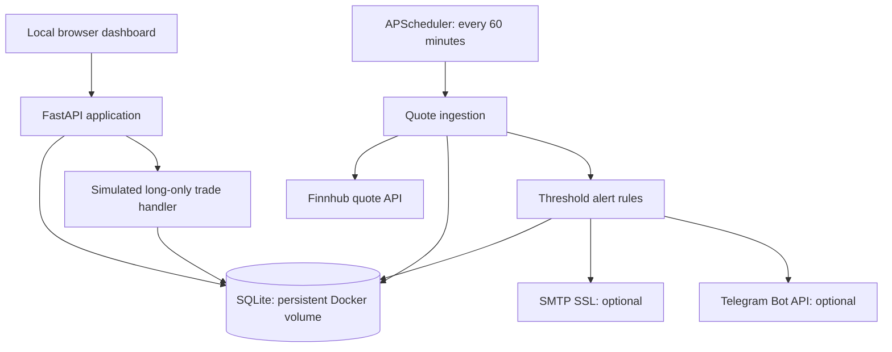

# AegisForge InvestIQ

**Local-first US stock monitoring and paper-trading MVP. No real-money orders. Not investment advice.**

> Status: prototype; automated tests and end-to-end Docker startup have **not been verified** in this environment. Do not expose the app to the internet or connect a live brokerage. The paper account starts with **virtual USD 1,000**, independent of your actual budget (under €1,000). No EUR conversion is implemented.

## What it does

- Tracks 15 symbols: `NVDA IONQ TSM MSFT AVGO MU CRWD RKLB OKLO CEG ASML VST ROK SOFI ENPH`.
- Fetches quotes from Finnhub hourly while the application is running, storing latest quotes and timestamped history in SQLite. Missing API keys do not generate fictional quotes.
- Displays a browser dashboard at `http://localhost:8000` and OpenAPI documentation at `/docs`.
- Supports price-threshold alerts on new market timestamps, with optional SMTP-over-SSL email and Telegram Bot API delivery. Telegram's own mobile notifications are an interim alternative; **native web/mobile push is not implemented**.
- Supports simulated long-only buys and sells using the latest stored quote, without margin or short selling. These are **not executable prices**; commissions, slippage, FX and corporate actions are not modeled.

## Repository layout

```text
AegisForge-InvestIQ/
├── .env.example          # Safe configuration template; copy to .env
├── .gitignore            # Excludes local secrets, databases and caches
├── Dockerfile            # Python application image
├── docker-compose.yml    # Single local service and persistent named volume
├── requirements.txt      # Python dependencies, including pytest
├── README.md             # This document
├── app/
│   └── main.py           # FastAPI routes, dashboard, SQLite, scheduler, alerts, paper trading
└── tests/
    └── test_api.py       # API and paper-trading tests
```

**GitHub upload tip:** Put the *contents* of the extracted `investiq/` directory at the root of your GitHub repository. Do not upload the ZIP as the only repository file. The `app/` and `tests/` directories are Python namespace-package directories in this MVP; their missing `__init__.py` files are intentional.

## Requirements

- Docker Desktop or Docker Engine with Docker Compose v2, or Python with a compatible version for the dependencies in `requirements.txt`.
- Finnhub API key from https://finnhub.io/ for quotes. Check your plan's access, quote delay, rate limits and terms; hourly collection does not guarantee real-time prices.
- Optional Telegram bot token and chat ID; optional SMTP SSL credentials for email alerts.

## Quick start: Docker (recommended)

1. Clone your repository (or extract the supplied archive and enter `investiq/`):

   ```bash
   git clone https://github.com/YOUR_USERNAME/AegisForge-InvestIQ.git
   cd AegisForge-InvestIQ
   ```

2. Create a private environment file:

   ```bash
   cp .env.example .env
   ```

   On Windows PowerShell use `Copy-Item .env.example .env`. Edit `.env` and set `FINNHUB_API_KEY`. **Never commit `.env`, API tokens, passwords or brokerage credentials.**

3. Start:

   ```bash
   docker compose up --build -d
   docker compose logs -f investiq
   ```

4. Open http://localhost:8000 and inspect API docs at http://localhost:8000/docs . The scheduler collects data every 60 minutes while the app is running. For a manual first fetch:

   ```bash
   docker compose exec investiq python -c 'from app.main import ingest; ingest()'
   ```

5. Stop without deleting the persistent volume:

   ```bash
   docker compose down
   ```

   **Do not use `docker compose down -v` unless you intend to delete the database and paper account.**

### Local-only networking

Compose binds port 8000 to `127.0.0.1`, not all network interfaces. The app has **no production-grade authentication**. Do not change this to `0.0.0.0`, publish it through a tunnel, or deploy it publicly without authentication, authorization, TLS, rate limiting and a security review.

## Configuration

| Variable | Purpose |
|---|---|
| `FINNHUB_API_KEY` | Quote API key; without it ingestion skips fetching. |
| `DB_PATH` | SQLite database location; Docker default `/data/investiq.db`. |
| `ENABLE_SCHEDULER` | `1` enables hourly ingestion; `0` disables it for tests. |
| `TELEGRAM_BOT_TOKEN` | Optional Telegram bot credential. |
| `TELEGRAM_CHAT_ID` | Optional destination chat ID. |
| `SMTP_HOST` | Optional SMTP server for SSL connection. |
| `SMTP_PORT` | SMTP SSL port, default `465`. |
| `SMTP_USER` | SMTP login and message sender. |
| `SMTP_PASSWORD` | SMTP password or app-specific password. |
| `ALERT_EMAIL` | Destination email address. |

All configuration names are documented in `.env.example`. Telegram and SMTP alerts are best-effort, not guaranteed delivery. Dashboard alerts work without messaging credentials.

## Architecture and data flow



This is **one local application**, not a distributed microservice architecture. Do not run multiple replicas of the scheduler against the same database. The dashboard refreshes once per minute; quote ingestion is hourly, not continuous. Fetch timestamps and market timestamps are distinct; closed markets can result in stale market timestamps.

## Database schema

The app initializes its tables in `app/main.py` using SQLite `CREATE TABLE IF NOT EXISTS` statements:

| Table | Key fields | Purpose |
|---|---|---|
| `quotes` | `symbol` (PK), `price`, `previous_close`, `market_timestamp`, `fetched_at` | Most recent accepted quote per symbol. |
| `history` | (`symbol`, `market_timestamp`) composite PK, `price`, `fetched_at` | Time-stamped price observations. |
| `alerts` | `id` (PK), `symbol`, `above`, `below`, `last_trigger` | User-defined price thresholds and throttle timestamp. |
| `trades` | `id` (PK), `symbol`, `side`, `quantity`, `price`, `created_at` | Simulated transaction records. |
| `paper_account` | `id` (single row), `cash` | Virtual USD cash balance. |

The schema is embedded in the application, not a separate SQL migration file. SQLite is intended for a single local instance. Database migrations, backup/restore commands, audit trails and multi-user support remain future work.

## API reference

Use http://localhost:8000/docs for request schemas and interactive documentation.

| Method | Path | Function |
|---|---|---|
| `GET` | `/` | Browser dashboard. |
| `GET` | `/api/quotes` | Latest stored quotations. |
| `GET` | `/api/history/{symbol}` | Stored history for a ticker. |
| `GET` | `/api/alerts` | List threshold alerts. |
| `POST` | `/api/alerts` | Create threshold alert. |
| `GET` | `/api/paper` | Virtual portfolio and account. |
| `POST` | `/api/paper/trade` | Simulate a buy or sell. |

For exact request bodies, use the generated OpenAPI docs rather than guessing field names. These endpoints are unauthenticated and must remain local.

## Tests

Run from the repository root after installing dependencies:

```bash
python -m pip install -r requirements.txt
ENABLE_SCHEDULER=0 python -m pytest -q
```

For PowerShell, set `$env:ENABLE_SCHEDULER="0"` first and then run `python -m pytest -q`. The tests are designed to use a temporary SQLite database without calling Finnhub. **Tests have not been confirmed passing in the build environment**, because dependency installation was unavailable. Fix any discovered failures before relying on the app.

The Docker image does not copy the `tests/` folder; run tests from a local Python environment or mount the source into a dedicated test container. The included Compose file is for running the application, not a preconfigured test service.

## Troubleshooting

- **Dashboard shows no quotes:** confirm `FINNHUB_API_KEY`, check `docker compose logs investiq`, trigger a manual fetch, and inspect provider access and limits. No quotes are fabricated.
- **Quotes appear old:** compare `market_timestamp` and `fetched_at`; the exchange may be closed or the provider delayed.
- **Port already in use:** stop the conflicting local service or change the *host* port in `docker-compose.yml` while retaining the `127.0.0.1` binding.
- **Notifications missing:** verify threshold rules, that a newly timestamped quote arrived, credentials, bot chat permissions, and the one-hour throttle.
- **Data missing after restart:** check whether the named Docker volume was removed; `down -v` deletes it.

## Security and investment limitations

- Research and simulated trading only: no broker connection, live orders or automated execution.
- Short investment horizons and capital below €1,000 can be disproportionately affected by fees, spreads, volatility and currency movements. This MVP does not calculate personalized suitability or guarantee profits.
- No login, role-based access control, encrypted secrets store, native mobile push, broker reconciliation, EUR FX, fees/slippage, stock-split adjustments, market calendar, comprehensive backtesting, or AI research assistant.
- Do not put API keys in code, screenshots, Git commits or issues. If exposed, revoke and rotate them immediately.
- Do not use this prototype as a production trading system.

## Roadmap (not implemented)

1. **Reliability and security:** validated startup/tests, authentication, secret management, health checks, migrations, backups, CI, structured logs.
2. **Portfolio correctness:** EUR/USD FX, transaction fees, spreads, corporate actions, market calendars, position/risk limits and robust valuation.
3. **Research:** filings/news ingestion with source citations, historical data, fee-aware backtests, paper-trading analytics.
4. **Notifications:** authenticated web/mobile push subscriptions, delivery queue, retries and user notification settings.
5. **Brokerage (read-only first):** supported provider integration, consent, token security, position reconciliation and audit logs. Live execution requires a separate design and explicit user authorization.

## GitHub publishing

Create an empty GitHub repository named `AegisForge-InvestIQ` (or your preferred name). From the extracted project directory:

```bash
git init
git add .
git status                 # Check .env is NOT staged
git commit -m "Initial local-first InvestIQ MVP"
git branch -M main
git remote add origin https://github.com/YOUR_USERNAME/AegisForge-InvestIQ.git
git push -u origin main
```

If the remote repository already contains commits, clone it first and copy the project files into the clone instead of force-pushing. Replace `YOUR_USERNAME` with your account. Use GitHub's credential manager or SSH; **never paste a personal access token into the README or remote URL**.

## License

No open-source license is included in this MVP. Add a license only after deciding how you want others to use, modify and distribute the code.
